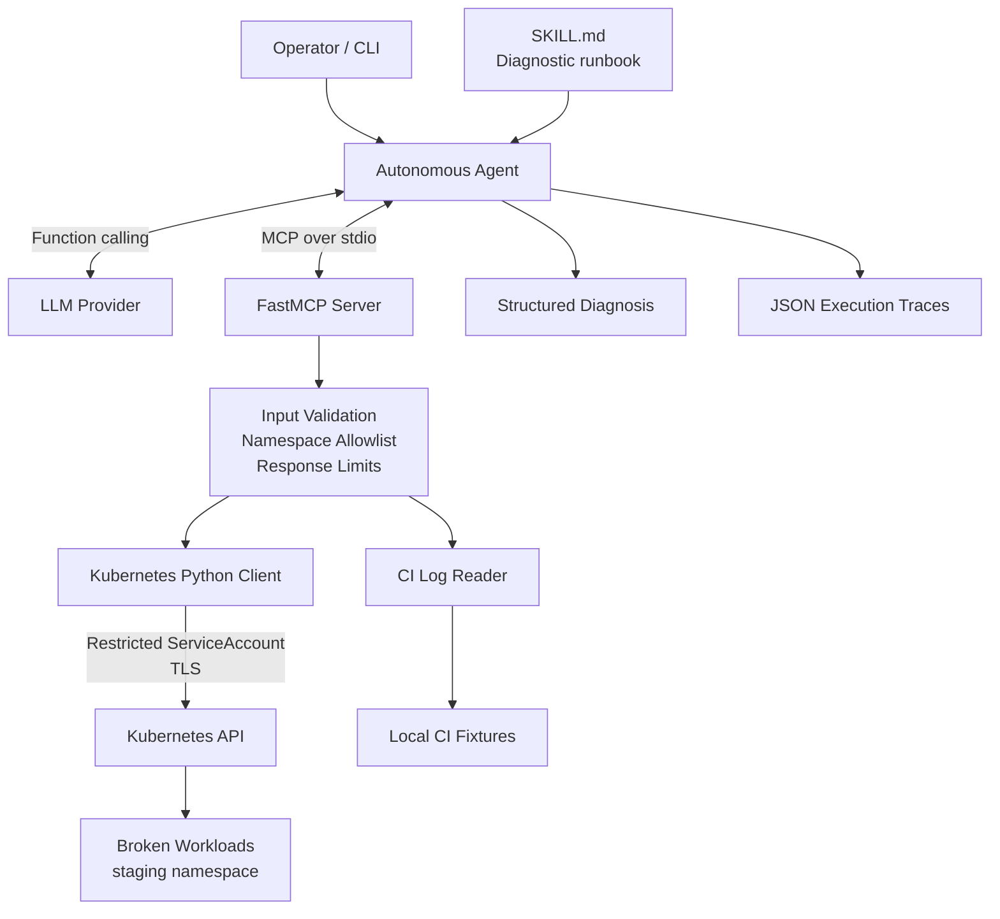

# DevOps AI Triage Toolkit

An autonomous, evidence-driven diagnostic agent for Kubernetes workload failures and CI/CD pipeline errors, built with Python, the Model Context Protocol (MCP), and an LLM-powered triage workflow.

The toolkit collects operational evidence, identifies likely root causes, and recommends actionable remediation without modifying infrastructure.

> **Read-only by design:** The agent investigates failures and suggests fixes. It never executes remediation.

## Table of Contents

- [Quick Start](#quick-start)
- [Architecture](#architecture)
- [Failure Scenarios](#failure-scenarios)
- [Usage](#usage)
- [MCP Server](#mcp-server)
- [Diagnostic Skill](#diagnostic-skill)
- [Agent Design](#agent-design)
- [Security](#security)
- [Docker Deployment](#docker-deployment)
- [Evaluation](#evaluation)
- [Example Diagnosis](#example-diagnosis)
- [Testing](#testing)
- [Configuration](#configuration)
- [Repository Structure](#repository-structure)
- [Design Decisions](#design-decisions)
- [Limitations and Future Improvements](#limitations-and-future-improvements)
- [Troubleshooting](#troubleshooting)
- [Cleanup](#cleanup)
- [AI Assistance](#ai-assistance)

## Quick Start

### Prerequisites

- Git
- Python 3.12
- Docker with Linux container support
- kind
- kubectl
- GNU Make
- Bash
- An API key for a compatible LLM provider

The implementation was developed and tested on Windows using Git Bash and Docker Desktop.

Linux and macOS users can use the equivalent Bash commands, subject to platform-specific Docker networking and credential permissions.

The default LLM configuration uses Google's Gemini OpenAI-compatible API. Another compatible endpoint and tool-capable model can be configured through environment variables.

### 1. Clone the repository

```bash
git clone https://github.com/DiabloGitHubX/devops-ai-triage-toolkit.git
cd devops-ai-triage-toolkit
```

### 2. Create a Python virtual environment

Windows with Git Bash:

```bash
py -3.12 -m venv .venv
source .venv/Scripts/activate
```

Linux or macOS:

```bash
python3.12 -m venv .venv
source .venv/bin/activate
```

Install the dependencies:

```bash
python -m pip install \
    -r mcp-server/requirements-dev.txt \
    -r agent/requirements.txt

python -m pip check
```

### 3. Configure the LLM provider

```bash
cp .env.example .env
```

Edit `.env` and provide your own API key.

```dotenv
LLM_BASE_URL=https://generativelanguage.googleapis.com/v1beta/openai/
LLM_API_KEY=
LLM_MODEL=gemini-3.5-flash-lite
```

The model must support function calling and be available to your provider account.

Do not commit `.env` or include credentials in diagnostic output.

The MCP server uses safe local defaults. Copy `.env.mcp.example` to `.env.mcp` only if you need to customize its configuration.

### 4. Provision the environment

Ensure Docker is running, then execute:

```bash
make env
```

This command:

1. Creates or reuses the dedicated kind cluster.
2. Creates the `staging` namespace.
3. Configures a restricted ServiceAccount and RBAC.
4. Deploys three intentionally broken workloads.
5. Generates a restricted kubeconfig.
6. Validates the ServiceAccount identity.
7. Performs 20 authorization checks.

Inspect the workloads:

```bash
kubectl --kubeconfig .runtime/kubeconfig get pods -n staging
```

Expected failure states after stabilization:

| Workload | Expected status |
|---|---|
| payments-api | ImagePullBackOff |
| orders-api | CrashLoopBackOff |
| analytics-worker | Pending |

The workloads are intentionally unhealthy. Do not wait for all pods to become Ready.

Image pulls, scheduling events, and restart backoff states may take time to stabilize.

### 5. Verify MCP connectivity

```bash
make mcp-smoke
```

This performs real MCP protocol integration checks without contacting an LLM.

### 6. Run your first investigation

Investigate a failed CI build:

```bash
make agent ARGS="--ci build-1424"
```

Investigate a Kubernetes workload:

```bash
make agent ARGS="--pod orders-api"
```

The agent prints a structured diagnosis to standard output and execution traces to standard error.

These commands make live LLM requests.

### Setup timing

A fresh local cluster recreation with cached container images completed in approximately 47 seconds during development.

This is not a cold-machine installation benchmark. Initial dependency installation, image downloads, workload stabilization, and LLM provider availability can increase the total setup time.

The quick-start workflow is designed to minimize manual configuration.

## Architecture



### Component responsibilities

| Component | Responsibility |
|---|---|
| Environment | Reproduce controlled Kubernetes and CI failures |
| MCP server | Expose bounded, read-only diagnostic tools |
| Skill | Teach the agent evidence-driven investigation procedures |
| Agent | Coordinate the LLM, MCP tools, budgets, and diagnosis |
| Evaluation harness | Measure diagnostic outcomes and execution constraints |
| Docker runtime | Package the agent and MCP server with runtime hardening |

The agent does not directly import or invoke Kubernetes diagnostic tool implementations. It discovers and calls them through the official MCP client and stdio transport.

## Failure Scenarios

### Kubernetes

The local kind cluster contains three intentionally broken Deployments in the `staging` namespace.

| Workload | Failure | Ground-truth root cause |
|---|---|---|
| payments-api | ImagePullBackOff | Nonexistent `nginx:triage-nonexistent-tag` image tag |
| orders-api | CrashLoopBackOff | Required `DATABASE_URL` environment variable is missing |
| analytics-worker | Pending | CPU request of 100 cores cannot be satisfied by the local node |

The Pending scenario assumes the local node has fewer than 100 allocatable CPU cores.

The kind node image is pinned by digest. The application images used by the failure scenarios are not all digest-pinned.

### CI/CD

The repository contains three synthetic but realistic CI failure logs modeled on common GitHub Actions pipeline failures.

| Job ID | Failed stage | Ground-truth root cause |
|---|---|---|
| build-1423 | Unit tests | Application accepts a negative payment amount |
| build-1424 | Docker build | Incorrect build context excludes the expected dependency file location |
| build-1425 | Helm validation | Missing `resources.requests` configuration mapping |

The logs are controlled fixtures, not recordings of actual external CI executions.

See [`fixtures/ci/`](fixtures/ci/).

## Usage

### Kubernetes investigations

```bash
make agent ARGS="--pod payments-api"
make agent ARGS="--pod orders-api"
make agent ARGS="--pod analytics-worker"
```

Specify the namespace explicitly:

```bash
make agent ARGS="--namespace staging --pod orders-api"
```

The agent discovers the exact pod name when given a workload name.

### CI investigations

```bash
make agent ARGS="--ci build-1423"
make agent ARGS="--ci build-1424"
make agent ARGS="--ci build-1425"
```

Use the job ID without the `.log` extension.

### Natural-language investigations

```bash
python -m agent "Why is orders-api repeatedly restarting in staging?"
```

```bash
python -m agent "Investigate the Docker build failure in build-1424."
```

Direct CLI invocation is also available:

```bash
python -m agent --namespace staging --pod payments-api
python -m agent --ci build-1424
python -m agent --help
```

The Makefile `ARGS` variable is intended for trusted operator input. For programmatic or untrusted input, invoke the Python CLI with an argument array rather than constructing a shell command.

### Capture a diagnosis and trace separately

```bash
mkdir -p artifacts/demo

python -m agent --ci build-1424 \
    > artifacts/demo/diagnosis.txt \
    2> artifacts/demo/trace.log
```

The agent returns a nonzero exit code when an investigation cannot be completed.

A successful process exit indicates that a diagnosis was produced, not that its technical conclusions are guaranteed to be correct.

## MCP Server

The diagnostic server uses the official Python MCP SDK and FastMCP.

Transport: **stdio**

### Available tools

| Tool | Arguments | Purpose |
|---|---|---|
| `list_pods` | `namespace`, `label_selector?` | Discover pods, readiness, restart counts, ages, and container states |
| `describe_pod` | `namespace`, `pod_name` | Inspect conditions, images, resource requests, termination states, and recent events |
| `get_pod_logs` | `namespace`, `pod_name`, `container?`, `tail_lines=100`, `previous=false` | Retrieve bounded current or previous container logs |
| `list_events` | `namespace`, `involved_object?` | Retrieve recent Normal and Warning events |
| `get_ci_log` | `job_id`, `failing_section_only=false` | Retrieve full or extracted CI failure evidence |

The `?` notation indicates an optional argument.

All five tools are read-only and include descriptions and parameter schemas for model-driven tool selection.

Log requests are restricted to 1–500 lines.

### Run the MCP server

```bash
make mcp
```

Equivalent command:

```bash
python mcp-server/server.py
```

This starts a stdio protocol server, not an interactive shell or HTTP endpoint.

Normally, the MCP client starts and manages the server subprocess automatically.

### Connect an MCP client

The following example uses the official MCP client and the same subprocess configuration used by the agent.

Run from the repository root with the virtual environment activated:

```python
import asyncio

from mcp import ClientSession
from mcp.client.stdio import stdio_client

from common.mcp_process import build_server_parameters


async def main():
    async with stdio_client(build_server_parameters()) as streams:
        async with ClientSession(*streams) as session:
            await session.initialize()

            tools = await session.list_tools()

            print([tool.name for tool in tools.tools])

            result = await session.call_tool(
                "list_pods",
                arguments={"namespace": "staging"},
            )

            print(result.model_dump_json(indent=2))


asyncio.run(main())
```

Save this example as a temporary Python file in the repository root and run it with the active virtual environment.

For another stdio-compatible MCP client, configure:

- Command: absolute path to the virtual environment's Python interpreter.
- Argument: absolute path to `mcp-server/server.py`.
- Working directory: repository root, when supported.
- Environment: the supported MCP configuration variables, if customization is required.

The default restricted kubeconfig is `.runtime/kubeconfig`.

Never configure the MCP server with the administrative kind kubeconfig.

### Protocol integration verification

```bash
make mcp-smoke
```

The smoke test discovers the actual tool inventory, exercises diagnostic calls, verifies unauthorized requests are rejected, and checks session recovery.

It does not require an LLM API key.

## Diagnostic Skill

The investigation runbook is defined in:

[`skills/k8s-triage/SKILL.md`](skills/k8s-triage/SKILL.md)

The Skill contains 251 lines and includes:

- Activation and exclusion criteria.
- Explicit MCP tool names and arguments.
- Kubernetes and CI investigation entry points.
- Branching diagnostic decision rules.
- Evidence collection and stopping rules.
- Read-only safety requirements.
- Confidence and uncertainty handling.

Supported diagnostic branches include ImagePullBackOff, CrashLoopBackOff, OOMKilled, Pending, application test failures, infrastructure failures, and configuration validation failures.

The Skill is injected into the agent's investigation context.

### Required diagnosis format

Every investigation is expected to return:

1. **Symptom** — Observable failure.
2. **Evidence** — Relevant diagnostic observations and their sources.
3. **Root cause** — Explanation supported by the evidence.
4. **Suggested fix** — Actionable remediation or next diagnostic step.
5. **Confidence** — High, medium, or low, with justification.

If evidence is insufficient, the agent must report an unknown root cause rather than inventing an explanation.

### Deterministic CI helper

The Skill includes an offline helper for extracting CI failure markers and surrounding context.

```bash
python skills/k8s-triage/scripts/extract_ci_error.py \
    fixtures/ci/build-1424.log
```

Structured JSON output:

```bash
python skills/k8s-triage/scripts/extract_ci_error.py \
    fixtures/ci/build-1424.log \
    --json
```

The helper and MCP CI tool share the same deterministic extraction implementation.

Failure extraction identifies relevant log sections; it does not independently determine the root cause.

During autonomous investigations, the agent retrieves CI evidence through MCP rather than executing the helper directly.

## Agent Design

The agent uses a custom asynchronous tool-calling loop with an OpenAI-compatible LLM client.

### Investigation lifecycle

1. Load and validate provider configuration.
2. Load the diagnostic Skill.
3. Start the MCP subprocess and initialize the session.
4. Discover and validate the five diagnostic tools.
5. Send the investigation context and tool schemas to the LLM.
6. Validate requested tool names and arguments.
7. Execute permitted requests through MCP.
8. Return diagnostic evidence to the LLM.
9. Continue until a diagnosis is produced or a stopping condition is reached.
10. Return the diagnosis and structured execution metrics.

The custom loop provides explicit control over tool dispatch, error handling, execution limits, and trace generation.

### Default investigation limits

| Limit | Default |
|---|---:|
| Tool attempts | 10 |
| LLM requests | 12 |
| Reported token budget | 30,000 |
| Maximum output tokens per request | 2,048 |
| LLM request timeout | 60 seconds |
| MCP request timeout | 45 seconds |
| Overall investigation runtime | 300 seconds |

The agent checks estimated prompt size before requesting additional model output and tracks provider-reported usage afterward.

The token budget is a best-effort execution control, not an absolute provider billing guarantee. Failed requests may omit token usage, and prompt estimation is approximate.

The investigation deadline applies to the investigation loop, not every aspect of process startup and shutdown.

### Failure handling

The agent handles invalid tool arguments, unsupported tools, repeated identical calls, timeouts, budget exhaustion, and provider failures.

When an investigation cannot be completed, it returns an incomplete diagnosis with an explicit stop reason and low confidence.

Automatic provider retries are disabled.

### Structured logging — Optional Bonus

Agent execution traces are emitted as JSON records on standard error.

Recorded fields include:

- Investigation ID and timestamp.
- Tool name and diagnostic purpose.
- Tool success or failure.
- Execution duration.
- LLM request count.
- Reported token usage.
- Provider error category and HTTP status.
- Final completion status and stop reason.

Example record structure, with illustrative values:

```json
{
  "component": "agent",
  "event": "tool_call_completed",
  "investigation_id": "example-investigation-id",
  "step": 1,
  "tool": "get_ci_log",
  "status": "success",
  "duration_seconds": 0.005
}
```

Agent trace records exclude raw queries, tool arguments, tool results, and credential values.

MCP server operational logs also appear on standard error, so the complete stderr stream is not exclusively JSON.

The evaluator identifies structured agent records separately.

## Security

Security is enforced at multiple layers rather than relying exclusively on model instructions.

### Least-privilege Kubernetes access

The MCP server authenticates using:

```text
system:serviceaccount:staging:triage-reader
```

The dedicated namespace-scoped Role grants:

| Resource | Allowed verbs |
|---|---|
| pods | get, list |
| pods/log | get |
| events | list |

The custom Role does not grant access to Secrets, ConfigMaps, Deployments, nodes, pod execution, port forwarding, or workload mutations.

Kubernetes may grant authenticated identities additional default API discovery and self-review permissions independently of this custom Role.

Administrative credentials are used only by the operator-facing environment setup and credential generation scripts.

They are not provided to the diagnostic server.

### Restricted kubeconfig

The credential generation script creates a dedicated kubeconfig containing:

- A discovered Kubernetes API endpoint.
- Cluster CA certificate data.
- A temporary ServiceAccount token.
- A single restricted context.

The server validates the credential structure and verifies the authenticated ServiceAccount identity before performing Kubernetes diagnostics.

TLS verification remains enabled.

Refresh the host credentials when required:

```bash
make kubeconfig
```

The requested token lifetime defaults to eight hours. The actual lifetime is determined by Kubernetes.

Generated credentials are excluded from Git and Docker build contexts.

### Application-level safety controls

- Explicit namespace allowlist.
- Fixed read-only MCP tool inventory.
- Strict argument and resource-name validation.
- CI fixture path containment.
- Bounded log retrieval and response sizes.
- Bounded Kubernetes event scanning.
- Truncation indicators.
- Sanitized errors.
- Duplicate tool-call detection.
- Investigation budgets and timeouts.

Logs, events, and tool responses are treated as untrusted diagnostic data.

The Skill instructs the agent to ignore embedded instructions and avoid exposing sensitive information.

These controls reduce risk but do not constitute a complete prompt-injection defense or automated data-loss prevention system.

### Authorization verification

Environment provisioning performs 20 authorization checks:

- Four expected allowed operations.
- Sixteen expected denied operations.

Additional integration checks exercise actual forbidden requests and verify restricted identity and session recovery.

### Credential handling

Private configuration and generated credentials are excluded from version control.

The Docker launcher forwards only approved agent configuration variables and fixed MCP settings.

The API key is not embedded in the Docker image or passed as a literal command-line argument.

Privileged Docker daemon administrators may still inspect container environment variables.

Windows users should ensure that local credential files are protected by appropriate NTFS permissions. Unix-style `chmod` alone is not an NTFS access-control guarantee.

### External LLM data boundary

Diagnostic evidence is transmitted to the configured external LLM provider.

The controlled fixtures are suitable for this demonstration, but real production logs may contain confidential information or credentials.

Production deployment would require stronger redaction, data classification, provider governance, and network controls.

## Docker Deployment

The agent and MCP server can run together in a hardened container.

The Dockerfile is located at [`agent/Dockerfile`](agent/Dockerfile).

### Build the image

```bash
make docker-build
```

Default image:

```text
devops-ai-triage-toolkit:local
```

### Generate container credentials

The host kubeconfig normally references a loopback API endpoint that is not reachable from inside another container.

Generate a separate kubeconfig for the container:

```bash
make docker-kubeconfig
```

The container joins the kind Docker network and connects to the control-plane container using its discovered cluster name.

TLS verification and the restricted ServiceAccount identity are preserved.

The original host kubeconfig remains separate.

### Run a containerized investigation

```bash
make docker-agent ARGS="--ci build-1424"
```

```bash
make docker-agent ARGS="--pod analytics-worker"
```

### Runtime hardening

The container launcher configures:

| Control | Configuration |
|---|---|
| Runtime user | UID/GID 10001 |
| Root filesystem | Read-only |
| Linux capabilities | All dropped |
| Privilege escalation | No-new-privileges |
| Temporary storage | Bounded writable tmpfs |
| Memory | 512 MiB |
| CPU | 1 CPU |
| Process limit | 128 |
| Kubeconfig mount | Read-only |
| Container lifecycle | Automatically removed |

The multi-stage Dockerfile excludes development tests, evaluation code, private configuration, credentials, and local artifacts from the runtime build context.

The base image tag is configurable, but the default Python image and all transitive dependencies are not fully digest-locked.

### Native Linux credential permissions

The fixed container UID must be able to read the restricted kubeconfig.

On native Linux, a host-owned file with mode `0600` may not be readable by UID 10001.

Where supported, grant a narrowly scoped read ACL:

```bash
setfacl -m u:10001:r .runtime/kubeconfig.container
```

Reapply the ACL after regenerating the file if necessary.

Do not make credential files world-readable.

This permission adjustment depends on the host filesystem, Docker user mapping, and ACL support. The container deployment was verified on Docker Desktop, not independently across every Linux configuration.

### Deployment verification results

Three separate live container verification attempts were retained:

| Attempt | Target | Result |
|---|---|---|
| 1 | analytics-worker | Configuration failure |
| 2 | analytics-worker | Provider HTTP 503 after successful MCP calls |
| 3 | build-1424 | Successful CI diagnosis |

The first attempt exposed a difference between Docker env-file parsing and Python dotenv parsing. The launcher was corrected to validate and normalize configuration before starting Docker.

Separate containerized MCP checks verified 14 successful diagnostic operations and eight rejected invalid or unauthorized requests.

A complete containerized CI investigation succeeded. Containerized Kubernetes connectivity and diagnostic tool execution were verified, but a complete containerized Kubernetes diagnosis was not achieved in the recorded attempts.

See [`docs/container-verification/`](docs/container-verification/) for original outputs, execution traces, manual review, and integrity fingerprints.

These attempts are separate from the formal evaluation benchmark.

## Evaluation

The evaluation harness runs the agent against six predefined failure scenarios.

The evaluator checks:

- Process exit status.
- Investigation completion.
- Diagnosis structure.
- Root-cause concept matching.
- Evidence concept matching.
- Required diagnostic tool execution.
- Tool inventory restrictions.
- Trace integrity.
- Step, request, token, and runtime budgets.
- Subprocess execution and output capture.

Expected root causes are stored in the evaluation dataset and are not included in the agent's investigation prompt.

### Validate the evaluation dataset

```bash
make eval-validate
```

This does not execute investigations or make LLM requests.

### Run the live evaluation

```bash
make eval
```

Each case is attempted once. Automatic retries are disabled, and failed investigations remain part of the pass-rate denominator.

New evaluation artifacts are saved under:

```text
artifacts/eval/<run-id>/
```

The evaluation command returns a nonzero exit code if any case fails.

### Formal benchmark results

Recorded on November 25, 2026, using `gemini-3.5-flash-lite`.

Run ID: `20261125T132455Z-16dd8adc`

| Case | Result | Reported tokens |
|---|---|---:|
| Kubernetes ImagePullBackOff | PASS | 14,115 |
| Kubernetes CrashLoopBackOff | PASS | 20,587 |
| Kubernetes Pending | FAIL — HTTP 503 | 12,288 (partial) |
| CI test failure | PASS | 8,697 |
| CI Docker build failure | PASS | 8,672 |
| CI Helm validation failure | FAIL — HTTP 429 | 0 reported; usage unknown |

| Metric | Result |
|---|---:|
| Attempted cases | 6 |
| Passed cases | 4 |
| Failed cases | 2 |
| Automated pass rate | 66.67% |
| Completed investigations | 4/6 |
| Total subprocess wall time | 62.313 seconds |
| Successful MCP calls | 10/10 |
| LLM requests | 16 |
| Reported tokens | 64,359 |
| Complete token accounting | 4/6 cases |
| Automatic retries | 0 |

Both failed investigations encountered external LLM provider errors.

The Pending case successfully collected Kubernetes evidence before the provider returned HTTP 503.

The Helm validation case encountered HTTP 429 before executing a diagnostic tool.

Neither failed investigation fabricated a root-cause diagnosis.

The Pending root cause was successfully diagnosed during an earlier development run. That result does not replace or modify the formal benchmark outcome.

### Manual review

All four completed formal investigations identified the expected root causes.

However, manual review identified limitations in exact evidence quotation and remediation precision that were not detected by the automated concept-matching checks.

The evaluation dataset contains controlled synthetic failures, several of which were previously used during development. It is not an independent held-out benchmark.

Reported token usage may omit consumption from failed provider requests and must not be interpreted as a verified billing total.

### Preserved evaluation evidence

- [Formal evaluation report](docs/evaluation/report.md)
- [Machine-readable results](docs/evaluation/results.json)
- [Manual technical review](docs/evaluation/manual-review.md)
- [Baseline configuration and source fingerprints](docs/evaluation/baseline.json)
- [Original diagnoses and traces](docs/evaluation/cases/)

The original formal results were retained without rerunning failed cases or adjusting scoring after the benchmark.

## Example Diagnosis

The following is an abridged example based on the successful `orders-api` investigation. It is not a new evaluation result.

### Symptom

The `orders-api` workload in `staging` repeatedly crashes during startup and enters `CrashLoopBackOff`.

### Evidence

The pod description reports a waiting container with a previous terminated state and exit code 1.

The application log contains:

```text
ERROR: Required environment variable DATABASE_URL is not configured
```

### Root cause

The application exits during startup because the required `DATABASE_URL` environment variable is missing.

### Suggested fix

Update the owning Deployment manifest to provide the missing configuration using an appropriate Kubernetes Secret reference.

Illustrative container configuration fragment:

```yaml
env:
  - name: DATABASE_URL
    valueFrom:
      secretKeyRef:
        name: <existing-database-secret>
        key: <existing-secret-key>
```

Replace the placeholders with verified Secret metadata.

The proposed Secret must exist before the workload can use it.

No credentials are retrieved or invented, and the agent does not apply this configuration.

An authorized operator can verify rollout status after applying a reviewed fix.

### Confidence

High — the application log directly identifies the missing required environment variable.

See the [original diagnosis](docs/evaluation/cases/k8s-crash-loop.txt) and [execution trace](docs/evaluation/cases/k8s-crash-loop.trace.jsonl) for the unmodified model output.

## Testing

### Automated regression tests

```bash
make test
```

The latest complete regression verification produced:

```text
1219 passed, 1 skipped
```

The skipped test requires symbolic-link creation support that was unavailable on the Windows test account.

Tests cover MCP input validation, namespace restrictions, credential validation, path containment, response truncation, Kubernetes diagnostic behavior, CI extraction, Skill structure, agent budgets, tool dispatch, evaluation scoring, and Docker launcher safety.

The automated regression suite uses controlled test inputs and mocks where appropriate. Its pass count is not a measure of live LLM diagnostic accuracy.

### Linting and formatting

```bash
make lint
```

The project uses Ruff for Python linting and formatting.

### Dependency consistency

```bash
python -m pip check
```

### MCP integration tests

```bash
make mcp-smoke
```

Requires the local Kubernetes environment for Kubernetes integration checks.

No LLM requests are made.

### Evaluation dataset validation

```bash
make eval-validate
```

Validates the six evaluation cases without contacting an LLM.

### Live evaluation

```bash
make eval
```

Requires a configured provider API key and an available model.

## Configuration

### Agent configuration

Configuration is loaded from `.env` and supported environment variables.

Environment variables take precedence over dotenv values.

| Variable | Default |
|---|---|
| `LLM_API_KEY` | Required |
| `LLM_BASE_URL` | Gemini OpenAI-compatible endpoint |
| `LLM_MODEL` | gemini-3.5-flash-lite |
| `AGENT_MAX_STEPS` | 10 |
| `AGENT_TOKEN_BUDGET` | 30000 |
| `AGENT_MAX_LLM_CALLS` | 12 |
| `AGENT_MAX_OUTPUT_TOKENS` | 2048 |
| `AGENT_LLM_TIMEOUT` | 60 |
| `AGENT_MCP_TIMEOUT` | 45 |
| `AGENT_MAX_RUNTIME` | 300 |
| `AGENT_DEFAULT_NAMESPACE` | staging |

See [`.env.example`](.env.example).

### MCP configuration

| Variable | Default |
|---|---|
| `ALLOWED_NAMESPACES` | staging |
| `KUBECONFIG_PATH` | .runtime/kubeconfig |
| `KUBECONFIG_CONTEXT` | triage-reader |
| `CI_FIXTURES_DIR` | fixtures/ci |
| `MAX_PODS` | 100 |
| `MAX_EVENTS` | 50 |
| `MAX_RESPONSE_BYTES` | 32768 |
| `MAX_CI_FILE_BYTES` | 1048576 |
| `K8S_REQUEST_TIMEOUT` | 10 |
| `LOG_LEVEL` | INFO |

See [`.env.mcp.example`](.env.mcp.example).

The response limit applies to serialized diagnostic payloads, not necessarily the complete MCP transport envelope.

Namespace allowlist changes do not grant Kubernetes permissions. Corresponding RBAC and credential authorization must also be configured.

The supplied Docker launcher intentionally uses fixed staging-specific MCP settings rather than forwarding arbitrary host MCP configuration.

### Makefile targets

| Target | Purpose |
|---|---|
| `make help` | Display available commands |
| `make env` | Provision the local environment |
| `make kubeconfig` | Refresh restricted host credentials |
| `make mcp` | Start the MCP stdio server |
| `make mcp-smoke` | Run protocol integration checks |
| `make agent` | Run an autonomous investigation |
| `make eval` | Execute the live evaluation |
| `make eval-validate` | Validate evaluation cases offline |
| `make test` | Run automated regression tests |
| `make lint` | Check linting and formatting |
| `make docker-build` | Build the agent image |
| `make docker-kubeconfig` | Generate restricted container credentials |
| `make docker-agent` | Run the hardened containerized agent |
| `make clean` | Remove the local environment |

## Repository Structure

```text
devops-ai-triage-toolkit/
├── agent/
│   ├── agent_loop.py
│   ├── cli.py
│   ├── config.py
│   ├── llm_client.py
│   ├── mcp_client.py
│   ├── trace.py
│   ├── Dockerfile
│   ├── requirements.txt
│   ├── eval/
│   │   ├── cases.json
│   │   ├── evaluator.py
│   │   ├── runner.py
│   │   └── report.py
│   └── tests/
├── common/
│   ├── ci_extraction.py
│   └── mcp_process.py
├── env/
│   ├── kind-config.yaml
│   ├── namespace.yaml
│   ├── rbac.yaml
│   └── workloads/
├── fixtures/
│   └── ci/
├── mcp-server/
│   ├── server.py
│   ├── config.py
│   ├── credentials.py
│   ├── safety.py
│   ├── kubernetes_tools.py
│   ├── ci_tools.py
│   ├── requirements.txt
│   ├── requirements-dev.txt
│   └── tests/
├── skills/
│   └── k8s-triage/
│       ├── SKILL.md
│       └── scripts/
│           └── extract_ci_error.py
├── scripts/
│   ├── setup.sh
│   ├── generate-kubeconfig.sh
│   ├── cleanup.sh
│   ├── mcp_smoke_test.py
│   ├── run-agent-container.sh
│   └── run_agent_container.py
├── docs/
│   ├── evaluation/
│   └── container-verification/
├── .env.example
├── .env.mcp.example
├── .dockerignore
├── .gitignore
├── .gitattributes
├── pytest.ini
├── Makefile
├── AI_LOG.md
└── README.md
```

Generated local directories such as `.runtime/`, `.venv/`, and `artifacts/` are excluded from version control.

The tree above highlights the principal implementation files rather than every tracked file.

## Design Decisions

| Decision | Rationale |
|---|---|
| kind | Lightweight, reproducible local Kubernetes environment |
| Python | Suitable SDK ecosystem for MCP, Kubernetes, testing, and LLM integration |
| MCP stdio | Real protocol communication without exposing an additional network service |
| FastMCP | Official SDK with tool registration, schemas, and protocol handling |
| Custom agent loop | Explicit control over tool validation, budgets, and error handling |
| Separate diagnostic Skill | Keeps operational investigation knowledge independent of tool implementation |
| Restricted ServiceAccount | Enforces least privilege at the Kubernetes API |
| Namespace allowlist | Adds application-level isolation alongside RBAC |
| Local CI fixtures | Reproducible scenarios without external CI credentials |
| Deterministic CI extraction | Reduces irrelevant context while retaining failure evidence |
| Structured traces | Makes tool usage, provider failures, and execution metrics observable |
| Multi-stage Docker build | Separates dependency installation from runtime packaging |
| No automatic remediation | Preserves operator control and limits operational risk |
| Single-attempt formal evaluation | Retains provider failures and avoids selectively reporting successful retries |

The selected optional bonus is structured logging.

Additional bonuses such as Helm deployment of the MCP server and external GitLab CI integration were intentionally not implemented.

## Limitations and Future Improvements

### Current limitations

- LLM provider availability and rate limits can interrupt investigations.
- Automatic provider retries are not implemented.
- Incomplete diagnoses do not retain all previously collected evidence.
- Token estimation is approximate and failed requests may omit usage.
- Automated evaluation uses heuristic concept matching.
- Evidence quotations and proposed fixes require manual review.
- The evaluation dataset is small, synthetic, and not independently held out.
- The CI integration reads local fixtures rather than a live CI platform.
- Kubernetes events and logs may change, expire, or be truncated.
- The MCP server does not retrieve node metrics or broader cluster state.
- OOMKilled is covered by the Skill but is not a deployed evaluation scenario.
- The Pending scenario depends on local node capacity.
- The runtime does not provide a complete sandbox or automated sensitive-data redaction.
- Native Linux container credential permissions may require additional configuration.
- A completed containerized Kubernetes diagnosis was not achieved in the recorded deployment attempts.
- Dependency versions are specified directly, but transitive dependencies and runtime base images are not fully locked.

### Future improvements

1. Add bounded retries for transient provider failures, respecting rate limits and investigation budgets.
2. Preserve collected evidence in incomplete investigation reports.
3. Reduce repeated prompt context and token consumption.
4. Validate quoted evidence against original tool responses.
5. Improve remediation precision and distinguish verified values from placeholders.
6. Expand evaluation with unseen failures and semantic assessment.
7. Add stronger sensitive-data filtering before external LLM requests.
8. Introduce namespace-specific identities and policies for larger environments.
9. Support real CI integrations using scoped read-only credentials.
10. Improve cross-platform credential handling and dependency reproducibility.

Any production remediation workflow should remain separate from the read-only diagnostic agent and require appropriate authorization, review, and approval.

## Troubleshooting

### Docker is unavailable

Ensure Docker is running and configured for Linux containers:

```bash
docker info
```

### Kubernetes credentials have expired

Refresh the restricted credentials:

```bash
make kubeconfig
```

For container execution:

```bash
make docker-kubeconfig
```

### Workload failure states are not visible yet

Inspect pods and events:

```bash
kubectl --kubeconfig .runtime/kubeconfig \
    get pods -n staging
```

```bash
kubectl --kubeconfig .runtime/kubeconfig \
    get events -n staging
```

Allow time for image pulls and container restart backoff.

### MCP initialization or authorization fails

Verify the restricted identity:

```bash
kubectl --kubeconfig .runtime/kubeconfig auth whoami
```

Expected username:

```text
system:serviceaccount:staging:triage-reader
```

Run:

```bash
make mcp-smoke
```

Do not bypass an authorization failure by providing an administrative kubeconfig.

### LLM returns HTTP 429 or 503

HTTP 429 indicates a provider rate-limit or quota-related response.

HTTP 503 indicates temporary service unavailability.

Inspect the structured execution trace, check provider availability and account limits, and wait before manually starting another investigation.

A provider failure does not establish the workload's root cause.

### Container configuration is rejected

Verify that `.env` contains a valid API key, HTTPS endpoint, available model, and supported execution settings.

The Docker launcher validates the configuration before starting the container.

Do not print the API key or kubeconfig while troubleshooting.

### Container cannot read its kubeconfig

Verify the generated container kubeconfig exists and that the fixed container UID has narrowly scoped read access.

See [Native Linux credential permissions](#native-linux-credential-permissions).

## Cleanup

Remove the dedicated local kind environment:

```bash
make clean
```

This deletes the configured kind cluster and removes the default generated host and container kubeconfigs.

It does not remove:

- The private `.env` configuration.
- The Python virtual environment.
- The built agent image.
- Evaluation and development artifacts.
- Other kind clusters.

Custom credential paths must be cleaned up separately.

The cleanup target is an operator-controlled lifecycle command. It is not available as an agent diagnostic tool.

## AI Assistance

AI tools were used throughout development for implementation assistance, architecture review, debugging, test generation, security analysis, and documentation.

The development record documents delegated tasks, incorrect suggestions, observed failures, corrective actions, manual verification, and design decisions.

See [`AI_LOG.md`](AI_LOG.md).

## Author

Roy Levi

DevOps AI Triage Toolkit — DevOps Home Assignment: Skill, Agent & MCP

[GitHub repository](https://github.com/DiabloGitHubX/devops-ai-triage-toolkit)

---

## Fresh-checkout verification

On November 25, 2026, the project was independently
verified using a fresh GitHub checkout of implementation
commit `03654bd`.

The verification used a separate temporary workspace,
a new Python 3.12 virtual environment, a dedicated kind
cluster named `devops-triage-verify`, and newly generated
restricted ServiceAccount credentials.

No private configuration or credentials were copied
from the original project.

| Verification step | Result |
|---|---|
| GitHub clone and dependency installation | PASS (61 seconds) |
| Python dependency consistency | PASS |
| Independent virtual environment | PASS |
| Kubernetes cluster provisioning | PASS |
| Control-plane readiness reported by kind | 16 seconds |
| Intentional workload failure reproduction | PASS (3/3) |
| RBAC permission checks | PASS (20/20) |
| MCP protocol integration | PASS (8 seconds) |
| MCP security rejection checks | PASS (8/8) |
| CI diagnostics without Kubernetes credentials | PASS |
| Evaluation dataset validation | PASS (6 cases) |
| Verification environment cleanup | PASS |
| Original environment and evidence preservation | PASS |

### Verification limitations

- The host already had Docker, kind, kubectl, Git,
  GNU Make and Python installed.
- Existing Python package and kind node image caches
  were available.
- This was a fresh-checkout verification, not a
  completely cold-machine installation benchmark.
- The complete provisioning duration was not recorded
  because the initial failure-state polling script
  incorrectly relied on pod phase when checking a
  restarting container.
- Subsequent inspection confirmed container termination
  with exit code 1, repeated restarts, BackOff events,
  and the expected missing DATABASE_URL error.
- Previous container logs were unavailable during one
  inspection, but current logs established the cause.
- No additional live LLM requests were made during
  this verification.
- The original formal evaluation results remain
  unchanged.

The temporary cluster, checkout, virtual environment
and generated credentials were removed after verification.
The original cluster, pod identities, credentials,
Docker image and recorded evaluation evidence were
preserved.
